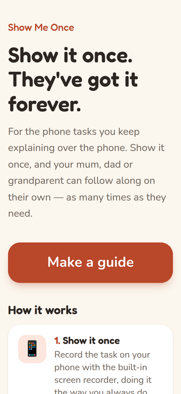
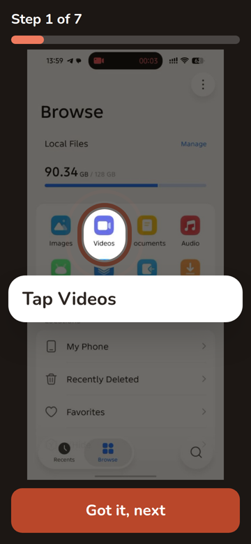
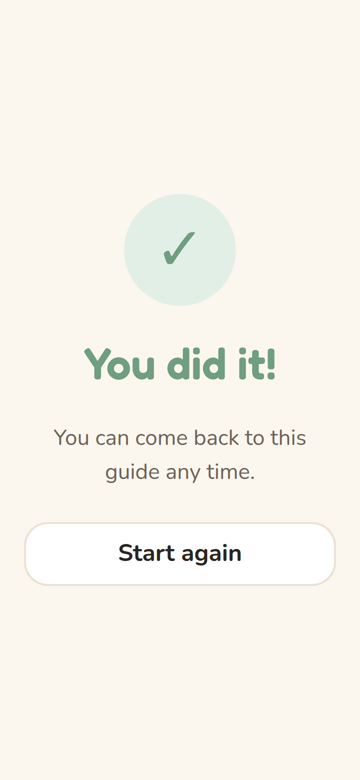

# Show Me Once

**Show it once. They've got it forever.**

Record a phone task once — joining the family WhatsApp call, sending a photo to a group — and Show Me Once turns it into a step-by-step tour your parent can follow on their own: their real screens, a glowing spotlight on what to tap, big text, and each step read aloud.

<p>
  
  
  
  
</p>

Built for the Devpost *Build With AI: Basics* hackathon. The plan lives in [`devpost/scope.md`](devpost/scope.md), [`devpost/prd.md`](devpost/prd.md) and [`devpost/spec.md`](devpost/spec.md); the build log is [`devpost/checklist.md`](devpost/checklist.md).

## Who it's for

- **The helper** — the adult child who keeps getting called to explain the same phone task. They record it once and send a link.
- **The learner** — a parent or grandparent who isn't confident with phones. They get one step at a time, big text, a clear "tap here", and a voice reading each step. No app to install, no account.

## How it works

1. **Create** — the helper names the task and picks a screen recording (3–90 s) or 2–15 screenshots. The browser pulls a frame every half second, drops frames where nothing changed (a ticked box or highlighted row still counts as a change), and keeps at most 24. The video never leaves the device.
2. **Build** — the frames go to a private Supabase bucket; the server sends them to Claude (vision + structured outputs). Claude finds each tap, the button that was tapped, and writes a plain instruction. Our own zod checks catch what a schema can't — a frame that doesn't exist, a circle off the screen, the word "click" — and ask Claude once more with the exact problems.
3. **Review** — the helper drags any circle that's off, rewords steps, deletes extras, and publishes. Unsure steps are highlighted, and screens that might show private info get a warning.
4. **Share** — an editable WhatsApp message with the link, or copy the link.
5. **Learn** — the parent taps **Start**: a dimmed screenshot with a pulsing spotlight, the instruction in large type, read aloud. Tapping the glowing circle (or "Got it, next") moves on; tapping elsewhere gently says "Tap the glowing circle." The tour ends with "You did it!"

## Stack

- **Next.js 16** (App Router, Cache Components) · **TypeScript** · **Tailwind CSS 4**
- **Supabase** — Postgres (one `guides` table, RLS on with no public policies) and a private Storage bucket
- **Anthropic Claude API** — `claude-sonnet-5-5` with image input and structured outputs (`@anthropic-ai/sdk`)
- **zod** for validation, **Vitest** for unit tests
- Browser APIs: `<video>` + canvas for frames, `speechSynthesis` for the voice
- Deployed on **Vercel**

## Set it up

You need Node 22+, a Supabase project, and an Anthropic API key.

1. **Install**

   ```bash
   npm install
   ```

2. **Environment** — copy `.env.example` to `.env.local` and fill in these names (never commit real values):

   | Variable | Where to find it | Secret? |
   |---|---|---|
   | `ANTHROPIC_API_KEY` | Anthropic Console → API Keys | yes — server only |
   | `ANTHROPIC_MODEL` | optional; defaults to `claude-sonnet-5-5` | no |
   | `NEXT_PUBLIC_SUPABASE_URL` | Supabase → Project Settings → API | no |
   | `NEXT_PUBLIC_SUPABASE_PUBLISHABLE_KEY` | publishable key (`sb_publishable_…`) or legacy anon key | no — it can read nothing |
   | `SUPABASE_SECRET_KEY` | secret key (`sb_secret_…`) or legacy service_role key | yes — server only |
   | `NEXT_PUBLIC_DEMO_GUIDE_ID` | optional; ID of a published guide (the part after `/g/` in its tour link) for the landing page's "See an example guide" button — hidden when empty | no |

3. **Database** — in Supabase open **SQL Editor → New query**, paste [`supabase/schema.sql`](supabase/schema.sql), and **Run**. Then check the setup (prints no secrets; creates the private bucket if it's missing):

   ```bash
   node --env-file=.env.local scripts/check-supabase.mjs
   ```

4. **Run**

   ```bash
   npm run dev
   ```

   Open http://localhost:3000. Phones can't reach `localhost`, so try the tour on a phone through a deployed URL.

5. **Test** — unit tests for the AI meaning-checks, frame selection and the share message:

   ```bash
   npm test
   ```

   In development, `/?force=ai_failed` and `/?force=no_steps` show those error screens without calling Claude.

## Deploy to Vercel

1. Push the repo to GitHub.
2. In Vercel: **Add New → Project**, import the repo (Next.js defaults are fine).
3. Add the environment variables above for **Production** and **Preview** (`NEXT_PUBLIC_DEMO_GUIDE_ID` is optional; redeploy after changing it, since `NEXT_PUBLIC_` values are built in).
4. Deploy. Keep **Fluid Compute** on (the default): the build route sets `maxDuration = 120`, within every plan's limit.

## Privacy and safety

- Nothing in Supabase is readable from the browser. All reads and writes go through server routes; the bucket is private and screenshots are served through signed links that expire after an hour (an open tour quietly fetches fresh ones).
- Each guide has a random edit key. Only its SHA-256 hash is stored; the helper keeps the key in the review link's `#fragment` and in their browser.
- Tour links are unguessable UUIDs. **Delete this guide** removes the guide and every screenshot.
- The create screen asks helpers not to record passwords, PINs or balances, and Claude flags screens that might show them.

## Known limits (proof of concept)

- No accounts: lose the review link (and the browser that saved it) and the guide can't be edited.
- Circles can be moved but not resized.
- No rate limiting; each guide build costs roughly $0.02–0.05 of Claude credit.
- HEVC recordings (newer iPhones' default) only open in browsers that decode HEVC — Safari does; some Android and desktop browsers don't, and show a friendly message with the iPhone "Most Compatible" setting and a screenshots option.
- The voice depends on the phone's built-in text-to-speech; without it the tour is text-only.
